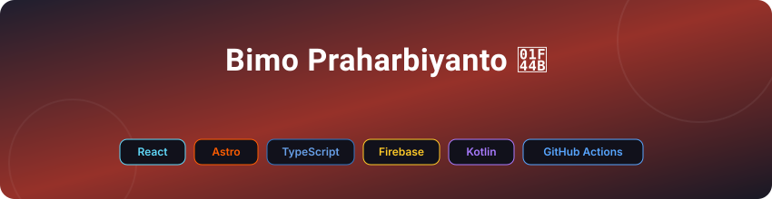

  

 

## 🚀 Project yang Udah Jadi

| Project | Deskripsi | Stack |
| :--- | :--- | :--- |
| **[Booking-Demo](https://github.com)** | Demo sistem booking lapangan badminton (mode data mock) | `TypeScript` `Web` |
| **[streamstore](https://github.com)** | Landing page statis buat pamer produk digital, sat-set tanpa build step | `HTML` `CSS` |
| **[setoran](https://github.com)** | Pencatat keuangan pribadi dengan sinkronisasi real-time & grafik | `TypeScript` `Firebase` |
| **[AdHunter](https://github.com)** | Pemindai izin & pemantau aplikasi Android (berjalan full offline) | `Kotlin` `Android` |

> Semua repo publik di sini pakai lisensi **MIT** — mau di-fork, dikulik, atau dimodifikasi buat belajar, silakan!

 

## ✍️ Di Luar Jam Ngoding

Kadang nulis catatan teknis, ngoprek sistem, dan cerita di balik layar bikin project di atas lewat **[blog.massbim.my.id](https://massbim.my.id)**.
